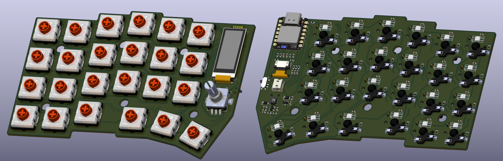

# VALKIRIA SPLIT

Completely wireless, split mechanical keyboard based on the nRF52840 microcontroller, with independent wireless operation for each half.

## Introduction

This is a personal project born from my interest in exploring the world of ergonomic mechanical keyboards. After looking at several existing designs, I found that none of them offered exactly what I was looking for, so I decided to design and build my own.

I took a bit of a gamble by choosing a Corne-inspired layout without a dedicated number row, opting for a more minimal design. However, if I find that this layout does not suit my needs, I plan to develop a new version with additional keys.

## Features

 - Completely wireless operation of both sides.

 - Rechargeable and replaceable battery.

 - Hot-swappable chocolate sockets.

 - Full RGB with switchable regulator.

 - Two 1.08" MIP displays.

 - Rotary encoders with push button.
